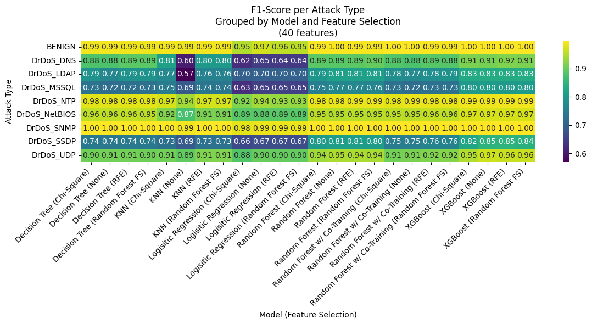
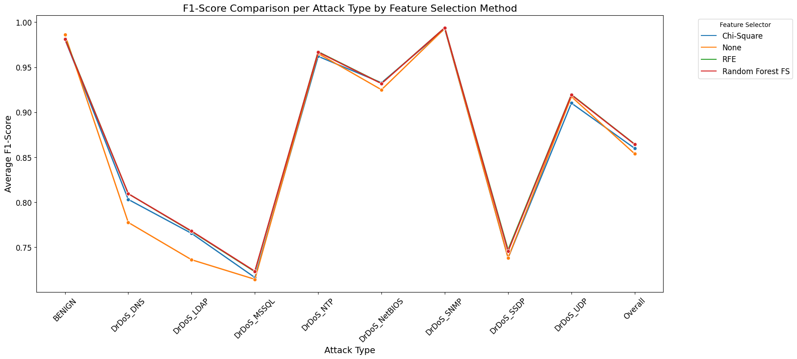
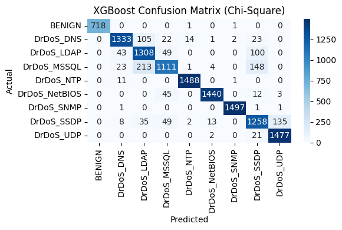

# Historical results (April 2025 Kaggle run)

> **Status: historical, not yet reproduced.** These outputs are taken directly from the recovered notebook
> [`notebooks/historical/phase-2-kaggle_Final04152025.ipynb`](../../notebooks/historical/phase-2-kaggle_Final04152025.ipynb).
> They are shown to document the original experiment. They are **not** final research claims; see the caveats below.

## Setup recorded in the notebook

- **Data:** 8 CIC-DDoS2019 DrDoS files, sampled at 300 benign + 5,000 attack rows per file
- **Split:** 29,680 train / 12,720 test rows · 9 classes (BENIGN + 8 DrDoS attacks)
- **Feature selection:** None, Random-Forest importance, Chi-Square (`SelectKBest`), RFE, each keeping **40 features**
- **Models:** Logistic Regression, KNN, Decision Tree, Random Forest, XGBoost, plus two exploratory variants (RF "co-training," DT entropy)

## Per-attack F1 across all 24 model × selector combinations

## Average F1 per attack type by feature-selection method

## Final cell outputs (Chi-Square, 40 features)

The notebook's execution order shows the last model runs (cells 62–70) followed the Chi-Square selection cell (61), and the confusion-matrix titles confirm "(Chi-Square)".

| Model | Accuracy | Macro F1 | Weighted F1 |
| --- | ---: | ---: | ---: |
| **XGBoost** | **0.914** | **0.92** | **0.91** |
| Random Forest + "co-training" variant | 0.895 | 0.900 | 0.894 |
| Random Forest | 0.895 | 0.90 | 0.89 |
| DT + entropy variant | 0.880 | 0.886 | 0.880 |
| Decision Tree | 0.879 | 0.89 | 0.88 |
| KNN | 0.865 | 0.87 | 0.86 |
| Logistic Regression | 0.707 | 0.71 | 0.69 |

## What the historical run suggests

- **Tree ensembles led.** XGBoost had the highest or tied-highest F1 on nearly every attack class under every feature-selection method, followed by Random Forest.
- **Feature selection mattered less than the model.** Averaged across models, the four selectors finished within about one F1 point of each other. The largest gains over "None" were on DrDoS_DNS and DrDoS_LDAP.
- **Some reflection attacks are hard to separate.** DrDoS_MSSQL, DrDoS_LDAP, and DrDoS_SSDP were the weakest classes for every model. The confusion matrices show them mostly being mistaken for each other. BENIGN, NTP, and SNMP were almost always classified correctly.
- **KNN without selection did worst on DNS/LDAP** (F1 0.60 / 0.57), which points to sensitivity to irrelevant or poorly scaled features.

## Caveats found during the review (why these are not final)

1. **Possible label leakage.** Every selector's top-40 list includes `Unnamed: 0`, a leftover row-index column, and `Source Port`. The dataset was built file by file, one attack type per file, so the row index can encode the label. Both columns must be dropped before selection in the rerun, and scores may fall once they are.
2. **"Co-training" and "entropy sampling" variants** are, in the recorded code, a standard Random Forest and an entropy-criterion Decision Tree. They are not semi-supervised or active-learning methods, so they should be treated as baselines.
3. **Out-of-order execution.** Cells were run out of order (selection cells were toggled between runs), and the final summary table accumulated rows across runs. The rerun will execute top to bottom with fixed seeds.
4. **Feature selection was fit on the full training set before the classifiers**, which is correct. The rerun will also wrap scaling and selection in a single `Pipeline` so this is enforced.

## All figures

| Figure | File |
| --- | --- |
| Class distribution | [class_distribution.png](figures/class_distribution.png) |
| Feature scaling | [scaling.png](figures/scaling.png) |
| Confusion matrices | [XGBoost](figures/confusion_xgboost.png) · [Random Forest](figures/confusion_random_forest.png) · [Decision Tree](figures/confusion_decision_tree.png) · [KNN](figures/confusion_knn.png) · [Logistic Regression](figures/confusion_logistic_regression.png) · [RF variant](figures/confusion_rf_cotraining.png) · [DT variant](figures/confusion_dt_entropy.png) |
| F1 by attack and selector | [chart A](figures/f1_by_attack_and_fs_a.png) · [chart B](figures/f1_by_attack_and_fs_b.png) |
